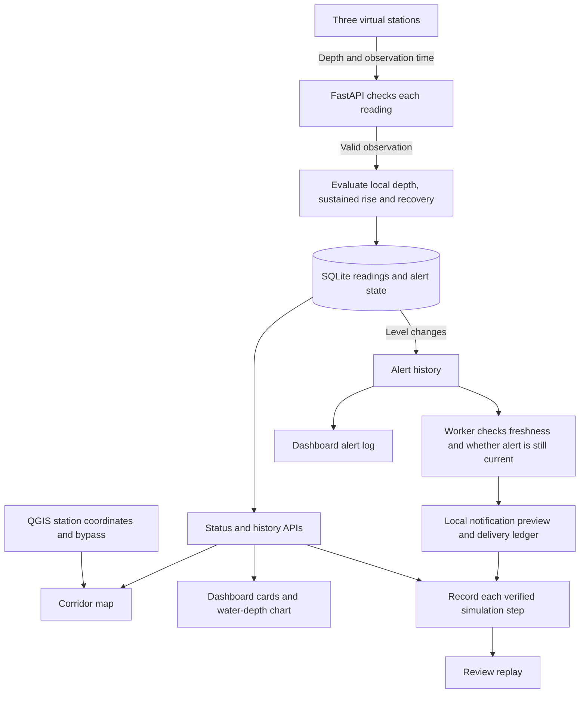

# How STREAM works

A rising upstream station can give an operator an earlier reason to check the next station. For example, the sustained-rise scenario raises a warning while the water is still below that station’s first depth threshold. The operator can inspect the readings behind the warning. The prototype runs on a laptop with three virtual stations.

## From reading to warning



1. **Measure.** The simulator sends a depth in metres, station ID, source and observation time for the lake outlet, Dasarahalli culvert and Manyata Gate 4.
2. **Check and save.** The backend accepts valid readings, recognizes a retry of the same observation and rejects conflicting or out-of-order submissions. It saves the reading, station state and any level change together.
3. **Decide.** Each station has its own depth thresholds. Repeated, sustained rise can also trigger a warning. A single reading at critical depth triggers RED. Recovery needs supporting fresh readings. A station that stops reporting becomes unknown on the live dashboard.
4. **Display.** The dashboard loads station locations from the QGIS exports. The operator sees the water-depth history, freshness and the backend’s reason. Gate 4 route illustrations carry no road-passability guarantee.
5. **Preview.** The worker checks that a transition is fresh and still current. In an isolated rehearsal, it records the dry-run message in the run’s own ledger. An ordinary reading at the same level produces no new alert.
6. **Review.** Each checkpoint records the actual API response and the worker’s previews. The runner compares the final history, transition order and preview IDs with the scenario. The replay becomes **Verified** after the run passes its checks. Historical steps keep their original evidence as the live dashboard ages.

## Review 1 · a three-minute walkthrough

Use the **Progressing surge** recording. Start on the [local dashboard](http://127.0.0.1:8001/). If you launched a rehearsal on another port, use the URL in its terminal. Keep this walkthrough open beside the dashboard. The replay lets you pause at each step for questions.

| Action | What to say |
| --- | --- |
| **1. Start at Corridor overview.** Point to the three places from left to right. | “Our project helps an operator see where water is rising between Rachenahalli Lake and Manyata Gate 4. For this prototype, three virtual stations send water-depth readings to our laptop.” |
| **2. Look at Fresh stations.** If you see **0 / 3** after the recording ends, leave it on screen for a moment. | “Fresh means we heard from the station recently. Once updates stop, the dashboard shows that we don’t know the current water level. We can still inspect the saved readings.” |
| **3. Click station 01 on the map, then tick Depth thresholds above the chart.** Click a point on the curve or move its time slider. | “This is the lake outlet. Its first depth warning starts at 0.50 metres. Here the recorded depth rose from 0.20 to 0.85 metres. The later readings crossed higher warning levels.” |
| **4. Click Review replay, then Upstream advisory.** Point to the three station cards. | “At this step only the lake outlet has turned YELLOW. The middle station and Gate 4 are still GREEN. That gives the operator a reason to watch downstream.” |
| **5. Select Downstream advisory.** Open the Gate 4 notification under **Notification previews**. | “Now the lake outlet is RED at 1.65 m, Dasarahalli is ORANGE at 1.25 m, and Gate 4 is YELLOW at 0.90 m. This is the message the software prepared for Gate 4. You can see the station, depth and reason. The review runs entirely in dry-run mode.” |
| **6. Choose Immediate local critical depth.** Point to Gate 4 and the totals. | “Gate 4 has now reached RED in this simulation. The backend saved 18 readings across six steps and recorded nine level changes. Each change produced one local notification preview.” |

**Close with the purpose.** “An operator can see which station changed, why it changed, and how recent the evidence is. Field measurements would be needed to validate a real flood warning time.”

### Start a fresh live run

After [setup](../README.md#run-the-review), use this PowerShell command from the project folder. It chooses an available port so you can keep a previously saved demo open.

```powershell
.\.venv\Scripts\python.exe 02_backend/simulate.py progressing-surge --speed 5 --port 0 --keep-server
```

Open the **Dashboard** URL printed in that terminal. A new step arrives about every six seconds. After the last step, **Review replay** stays available while the server is running. Press Ctrl+C in that terminal to stop that run.

If someone asks how a warning clears, use the same command with `recovery`. In its replay open **First recovery observation**, then **Recovery confirmed**. At Gate 4, one low reading holds RED. A second qualifying reading confirms GREEN and produces a recovery preview.

## Other situations to demonstrate

| Profile | Evidence to look for |
| --- | --- |
| `normal` | Stable depths and zero transitions. |
| `sustained-rise` | Repeated upstream rises produce YELLOW and then ORANGE below the first depth threshold. |
| `isolated-spike` | A single below-threshold jump produces no sustained-rise alert. |
| `sensor-dropout` | Dasarahalli stops reporting and becomes stale. The other two remain fresh. Add `--stale-after-seconds 10` for a shorter wait. |

The monitoring view polls the backend for current conditions. The replay uses the recorded step even if you present later. Each managed run prints its folder under `02_backend/data/simulation_runs/`. It contains the scenario plan, checked report, telemetry database, backend log and the review database. See [simulation details](../02_backend/SIMULATIONS.md) for how to reopen a run.

## What the review demonstrates

The software demonstrates ingestion, local warning decisions, missing-data handling and notification previews. The map uses proposed locations and illustrative routes. Real sensor accuracy, warning lead time, public road safety and delivery to an actual phone all require separate field or delivery checks. The simulated timeline is measured in scenario seconds.
